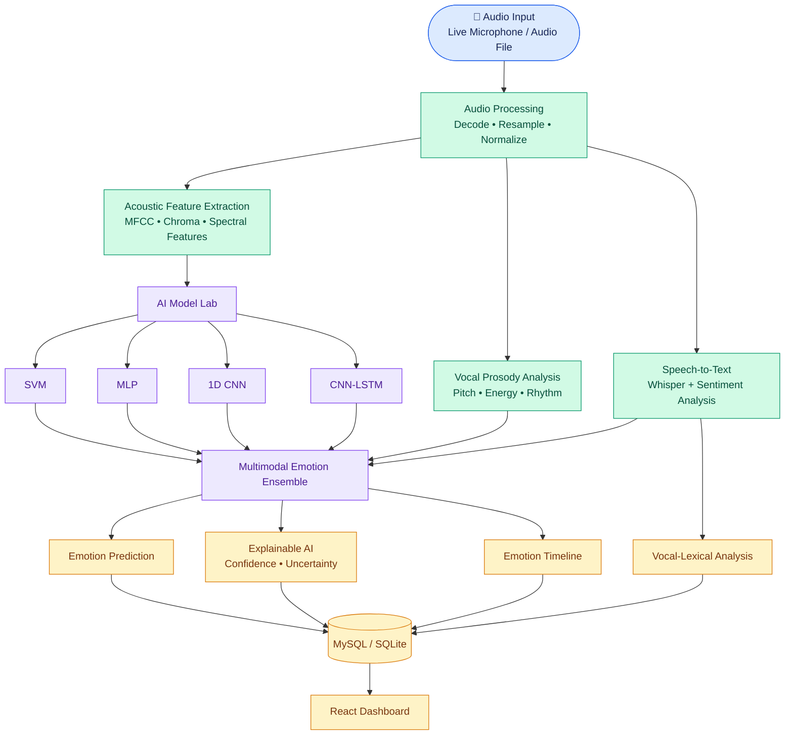
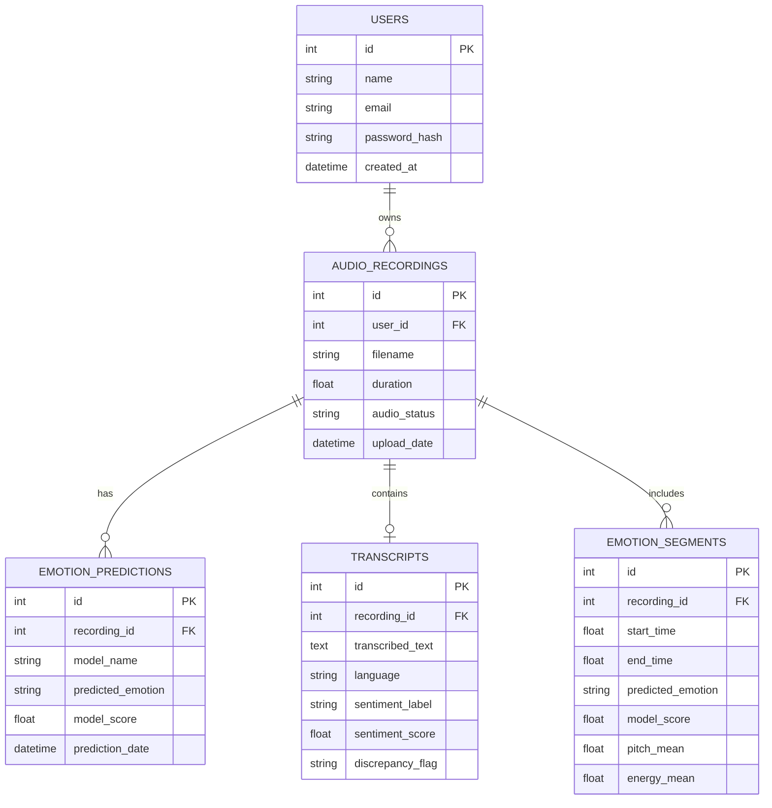
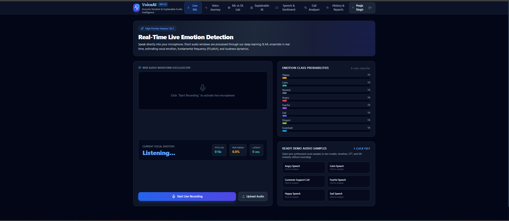
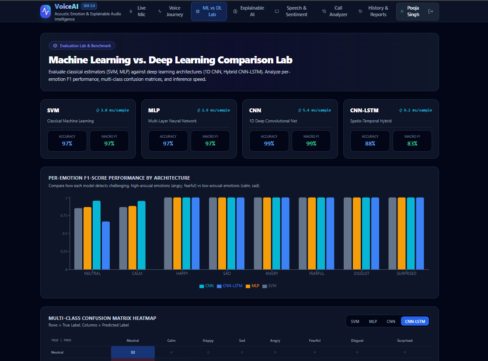
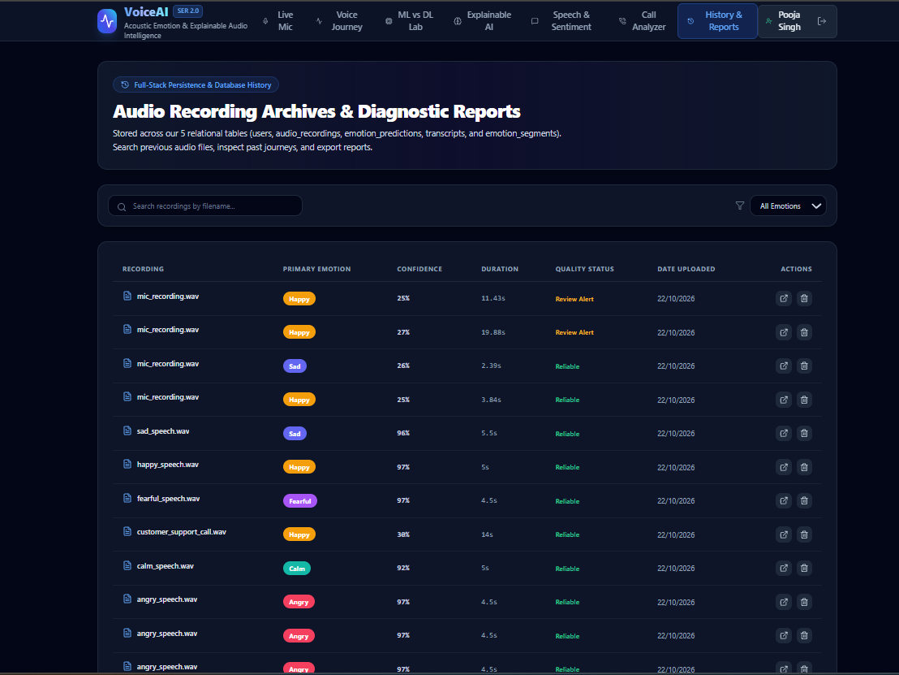
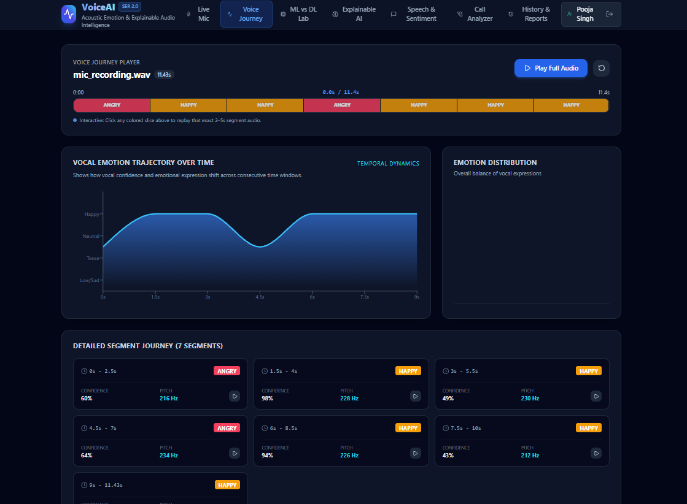
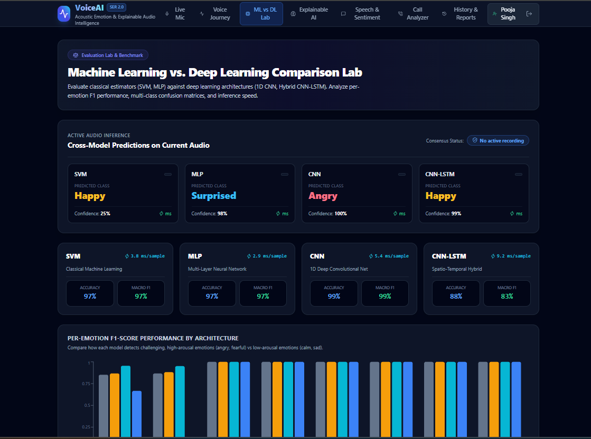
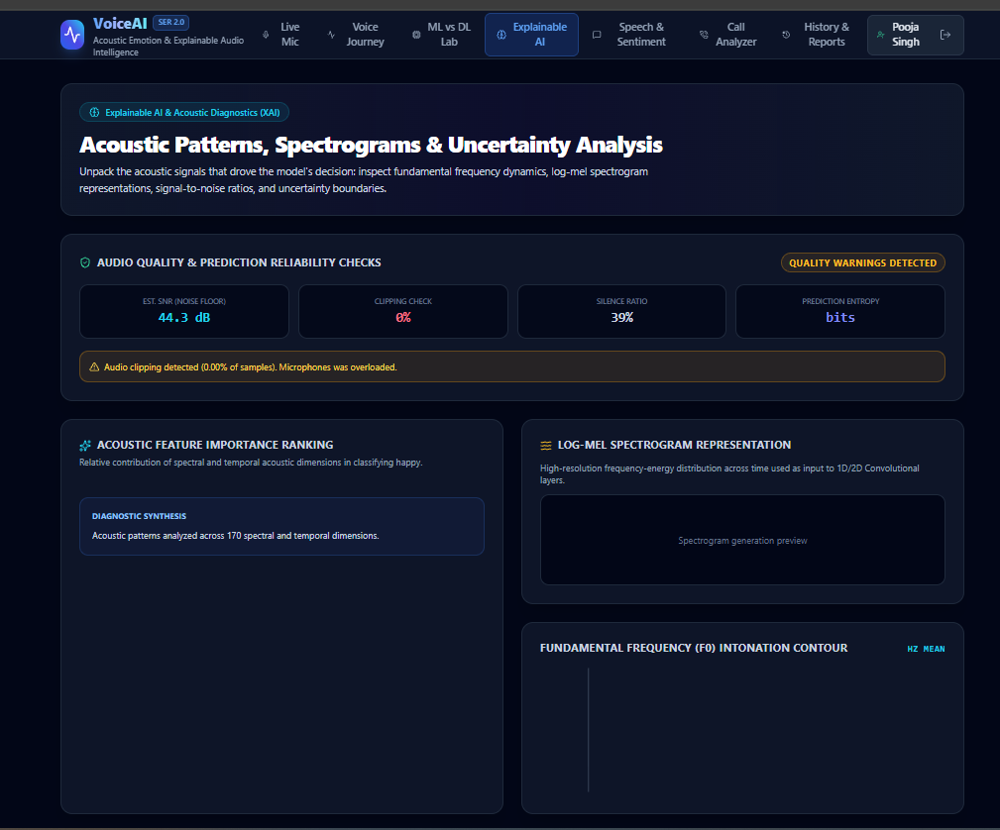
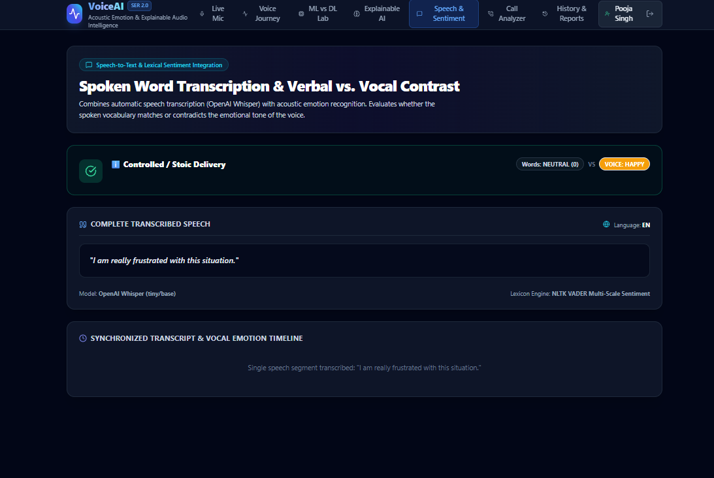

# 🎙️ VoiceAI — Multimodal Speech Emotion Recognition

<p align="center">
  <b>Understand the voice behind the words.</b><br/>
  An AI-powered platform for speech emotion recognition, acoustic analysis,
  speech transcription, sentiment analysis, and explainable AI.
</p>

<p align="center">
  
  
  
  
  
  
</p>

---

## 📌 Table of Contents

- [Overview](#-overview)
- [Problem Statement](#-problem-statement)
- [Objectives](#-objectives)
- [Key Features](#-key-features)
- [Supported Emotions](#-supported-emotions)
- [System Architecture](#-system-architecture)
- [AI and ML Models](#-ai-and-ml-models)
- [Database ER Diagram](#-database-er-diagram)
- [Technology Stack](#-technology-stack)
- [Project Structure](#-project-structure)
- [Installation and Setup](#-installation-and-setup)
- [Running the Application](#-running-the-application)
- [API Documentation](#-api-documentation)
- [Testing](#-testing)
- [Screenshots](#-screenshots)
- [Limitations and Privacy](#-limitations-and-privacy)
- [Future Enhancements](#-future-enhancements)
- [Author](#-author)

---

## 🚀 Overview

VoiceAI is a multimodal Speech Emotion Recognition (SER) platform
designed to analyze how a person speaks and what they say.

It combines acoustic feature extraction, vocal prosody analysis,
machine learning, deep learning, speech-to-text transcription,
sentiment analysis, and Explainable AI (XAI).

The system is designed to analyze audio recordings or live microphone
input and present emotion predictions, confidence scores, acoustic
insights, and other analysis results through a dashboard.

> Emotion predictions are estimates based on audio and language signals.
> They do not establish a person's actual internal emotional state.

## 🎯 Problem Statement

Traditional speech analysis often focuses on recognizing spoken words
without fully considering vocal characteristics such as pitch, energy,
rhythm, and changes in speaking style.

VoiceAI aims to combine acoustic and linguistic information to provide
a richer analysis of spoken communication.

## 🎯 Objectives

- Analyze speech using acoustic and linguistic features.
- Classify speech into supported emotion categories.
- Extract vocal features such as pitch and energy.
- Generate speech transcripts and sentiment information.
- Compare machine learning and deep learning approaches.
- Present confidence and explainability information.
- Store recording and analysis information in a database.
- Provide an interactive dashboard for viewing results.

## ✨ Key Features

### 🎤 Audio Input
- Live microphone recording.
- Audio file upload and analysis.
- Audio decoding and preprocessing.

### 🧠 Emotion Recognition
- Acoustic feature extraction.
- Vocal prosody analysis.
- Machine learning and deep learning model comparison.
- Emotion probability and confidence visualization.

### 📝 Speech and Sentiment Analysis
- Speech-to-text transcription using Whisper.
- Sentiment analysis using NLTK VADER.
- Comparison of vocal emotion and lexical sentiment.

### 🔍 Explainable AI
- Prediction confidence and uncertainty indicators.
- Analysis of relevant acoustic features.
- Emotion timelines and segment-level analysis.

### 📊 Dashboard and Data Management
- Interactive visualization of analysis results.
- Database-backed recording history.
- User authentication, where configured.
- Customer support call analysis, where implemented.

*Feature availability depends on the current implementation and configuration.*

## 😊 Supported Emotions

The documented emotion classes are:

| Emotion | General description |
|---|---|
| Neutral | Relatively unmarked vocal expression |
| Calm | Relaxed and low-intensity vocal expression |
| Happy | Positive and energetic vocal expression |
| Sad | Low-energy, negative vocal expression |
| Angry | Frustrated or forceful vocal expression |
| Fearful | Anxious or apprehensive vocal expression |
| Disgust | Aversion or strong dislike |
| Surprised | Response associated with unexpected events |

These descriptions are illustrative, not definitive rules for interpreting
a person's emotional state.

---

## 🏗️ System Architecture

The following diagram illustrates the documented processing pipeline.



### Architecture Workflow

1. **Audio input:** Capture a recording through the microphone or upload an audio file.
2. **Preprocessing:** Decode and prepare audio for analysis.
3. **Parallel analysis:** Extract acoustic features, analyze vocal prosody,
   and generate speech transcripts and sentiment information.
4. **Model inference:** Evaluate supported machine learning and deep learning models.
5. **Emotion analysis:** Combine the available model outputs and analysis signals.
6. **Explainability:** Present confidence information and relevant analysis insights.
7. **Storage and visualization:** Store configured results and display them through the dashboard.

*This is a conceptual architecture based on the project documentation.
Actual data flow depends on the implementation.*

---

## 🤖 AI and ML Models

The project documentation describes the following models:

| Model | Approach | Purpose |
|---|---|---|
| SVM | Classical machine learning | Classification using acoustic features |
| MLP | Feed-forward neural network | Learn nonlinear feature relationships |
| 1D CNN | Deep learning | Learn local patterns in feature vectors |
| CNN-LSTM | Hybrid deep learning | Combine convolutional and sequential representations |
| Ensemble | Probability combination | Combine model predictions with other analysis signals |

### Acoustic Features

The documented feature vector contains 170 dimensions, including:

- **MFCC:** Spectral envelope and vocal characteristics.
- **Chroma:** Harmonic and pitch-class information.
- **Log-Mel Spectrogram:** Frequency-band energy.
- **Spectral Contrast:** Differences between spectral peaks and valleys.
- **Zero Crossing Rate:** Signal sign-change information.
- **RMS Energy:** Signal energy and intensity.
- **Spectral Centroid and Rolloff:** Frequency distribution characteristics.
- **Pitch and Voicing Proxies:** Vocal periodicity and pitch-related information.

### Explainable AI

The documented analysis includes:

- Prediction entropy for uncertainty estimation.
- Confidence margin between the leading predictions.
- Ranking of relevant acoustic features.

These indicators help communicate prediction uncertainty rather than treating every prediction as certain.

---

## 🗄️ Database ER Diagram

The following ER diagram summarizes the five relational tables described
in the project documentation.



### Database Tables

| Table | Purpose |
|---|---|
| `users` | User account information |
| `audio_recordings` | Uploaded or recorded audio metadata |
| `emotion_predictions` | Model predictions and scores |
| `transcripts` | Transcribed text and sentiment information |
| `emotion_segments` | Time-based emotion and acoustic analysis |

**Important:** Verify this summarized ERD against `models_db.py` and
`voice_analysis_workbench.sql` before treating it as the definitive schema.
The fields shown here are a documentation summary.

---

## 🛠️ Technology Stack

| Layer | Technologies |
|---|---|
| Frontend | React 18, Vite, Tailwind CSS |
| Data Visualization | Recharts |
| Browser Audio | Web Audio API |
| Backend | Python, FastAPI, Uvicorn |
| Machine Learning | Scikit-learn |
| Deep Learning | PyTorch |
| Audio Processing | Librosa, PyAV, SoundFile |
| Speech Recognition | OpenAI Whisper |
| Sentiment Analysis | NLTK VADER |
| Database | SQLAlchemy, MySQL, SQLite |
| Authentication | JWT, password hashing |
| API Testing | FastAPI Swagger UI |

---

## 📁 Project Structure

The following is an illustrative project structure. Update it to match
your actual repository files and folder names.

```text
VoiceAI-Speech-Emotion-Recognition/
│
├── backend/
│   ├── audio_processor.py
│   ├── ml_models.py
│   ├── call_analyzer.py
│   ├── models_db.py
│   └── train_or_bootstrap.py
│
├── frontend/
│   ├── src/
│   ├── public/
│   ├── package.json
│   └── vite.config.js
│
├── run_app.py
├── view_database.py
├── requirements.txt
├── voice_analysis_workbench.sql
├── .env.example
├── .gitignore
└── README.md
```

---

## 💻 Installation and Setup

### Prerequisites

Install the tools required by your configuration:

- Python 3.11
- Git
- Node.js and npm, if a separate frontend installation is required
- MySQL 8.0, if using MySQL instead of SQLite

### 1. Clone the Repository

```bash
git clone https://github.com/poojasingh7/VoiceAI-Speech-Emotion-Recognition.git
```

Enter the project directory:

```bash
cd VoiceAI-Speech-Emotion-Recognition
```

### 2. Create a Python Virtual Environment

Windows PowerShell:

```powershell
python -m venv .venv
```

Activate it:

```powershell
.\.venv\Scripts\Activate.ps1
```

If PowerShell blocks activation, use Command Prompt:

```bat
.venv\Scripts\activate.bat
```

### 3. Install Python Dependencies

```powershell
python -m pip install --upgrade pip
pip install -r requirements.txt
```

If the project uses additional system dependencies or model downloads,
install them according to the relevant package instructions.

### 4. Configure Environment Variables

Create a local `.env` file using `.env.example` as a reference.

Set the database URL and any required authentication secrets according
to the names expected by your actual code.

Never commit your local `.env` file.

### 5. Configure the Database

For MySQL:

1. Start your MySQL server.
2. Create or select the intended database.
3. Configure the database connection.
4. Apply the safe schema or initialization procedure required by the application.

For SQLite, use the application's configured database initialization process.

### 6. Install Frontend Dependencies

If the frontend is a separate Vite application, open a terminal in the
frontend directory:

```powershell
cd frontend
npm install
```

Run the frontend development server if the project requires one:

```powershell
npm run dev
```

Follow the instructions printed by Vite.

---

## ▶️ Running the Application

The project documentation specifies the following startup command from
the project root:

```powershell
python run_app.py
```

The documented local addresses are:

- **Web application:** http://localhost:8000
- **API documentation:** http://localhost:8000/docs

Verify these commands and addresses against the current code before
using them. Your configured frontend may run separately during development.

---

## 🔌 API Documentation

FastAPI can provide interactive API documentation through Swagger UI.

When the backend is running, open:

```text
http://localhost:8000/docs
```

Use the available endpoints to inspect and test the API. Authentication
and request requirements depend on the implemented routes.

---

## 🧪 Testing

Test the following workflows where implemented:

- [ ] User registration and login
- [ ] Authentication and protected endpoints
- [ ] Live microphone recording
- [ ] Audio-file upload
- [ ] Audio decoding and preprocessing
- [ ] Emotion prediction
- [ ] Confidence and probability visualization
- [ ] Speech-to-text transcription
- [ ] Sentiment analysis
- [ ] Emotion timeline generation
- [ ] Database storage and retrieval
- [ ] Invalid or unsupported audio handling

Document any limitations discovered during testing. Do not claim
accuracy or performance figures without supporting evaluation results.

---

## 🖼️ Screenshots


---

## 🖥️ Application Screenshots

### 🏠 Dashboard


### 🎭 Emotion Analysis


### 🎤 Audio Recording


### 📊 Analytics


### 📝 Speech Transcription


### 🤖 Model Results


### 💻 Application Interface



Example:

```markdown


```

Only include screenshots that exist in your repository. Remove any
personal information, credentials, and private recordings before publishing.

---

## 🔐 Limitations and Privacy

- Emotion classification is probabilistic and may be inaccurate.
- Audio quality, background noise, language, accent, and individual
  speaking styles may affect predictions.
- Sentiment analysis of transcripts does not necessarily reflect vocal emotion.
- Speech characteristics should not be used alone to make high-stakes
  judgments about individuals.
- Obtain appropriate permission before recording or processing voices.
- Do not commit passwords, authentication tokens, private audio, or
  databases containing real user information.
- Verify dataset licenses and model distribution terms before sharing assets.

---

## 🚀 Future Enhancements

Potential future improvements include:

- More robust multilingual speech analysis.
- Improved speaker and conversational-turn analysis.
- Model evaluation on diverse datasets.
- Better calibration of prediction confidence.
- Additional explainability visualizations.
- Secure deployment and production monitoring.
- Expanded automated testing and continuous integration.

These are potential improvements, not claims that every feature is implemented.

---

## 👩‍💻 Author

**Pooja Singh**

MCA Student | AI and Machine Learning Enthusiast

- GitHub: [@poojasingh7](https://github.com/poojasingh7)

Add your LinkedIn profile, portfolio, or email here if you want to share them publicly.

---

## 📄 License

No license has been selected yet. Add a suitable license file if you decide
to permit reuse or redistribution of this project.

---

<p align="center">
  <b>VoiceAI — Bringing acoustic intelligence to speech analysis 🎙️</b>
</p>
